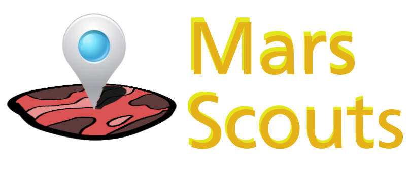

*** Welcome to Mars Scouts ***

Mars Scouts is designed to be a map tool for astronauts specifically investigating on Mars's ancient bodies of water. It also keeps astronauts away from physical danger by using visual red radii across the map in rough terrain and including a thermal overlay.

**Details** 

Mars Scouts is designed to be a map tool for astronauts specifically investigating on Mars's ancient bodies of water. It also keeps astronauts away from physical danger by using visual red radii across the map in rough terrain and including a thermal overlay.

Mars Scouts is designed to be tablet friendly for future astronauts on Mars investigating the Martian past. Icons and input bars are therefore made large for easier use. 

Unlike other maps, Mars Scouts uses a Large Language Model (LLM) for suggestions and questions during their mission.

The map is built using Vanilla JavaScript, jQuery and Leaflet.js. Most data, like the Jezero imagery, were sourced from NASA's Mars Trek. Jezero Crater was chosen as our main region of focus not only because of the potential in discovering breakthroughs in Mars's ancient past but also the wide amount of data collected by NASA's instruments and rovers like Perseverance. 

A.I has only been used for debugging and the correction of syntax errors and not generating ideas, info or UI.

**Simulated Data**

Do note the due to the environment, the following data was simulated:
  - Status bar Weather Info
  - Astronaut Movement

The Status Bar Weather Info is still based on real information: 

  Source: https://www.nasa.gov/directorates/stmd/nasas-first-weather-report-from-jezero-crater-on-mars/
  

**How to Use**

See Powerpoint presentation: [website][an_awesome_website_link].

[an_awesome_website_link]: https://www.spaceappschallenge.org/2026/find-a-team/mars-scouts/?tab=project
